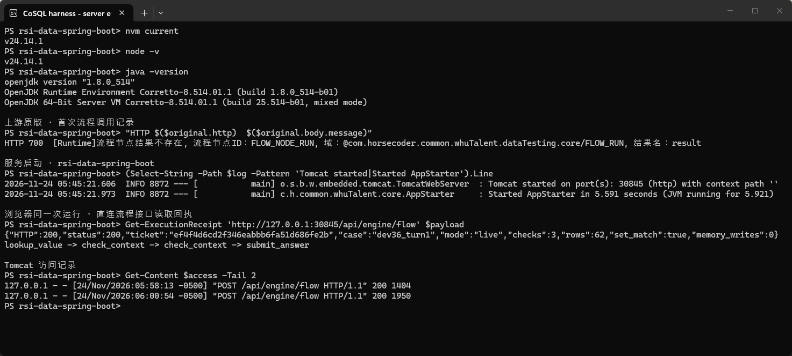
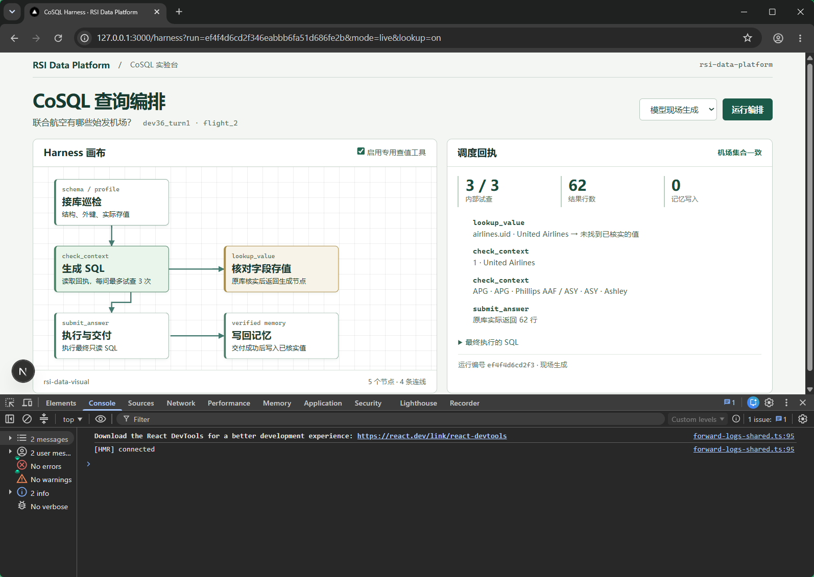

# RSI 数据平台与 CoSQL Harness 联调

第四周 4.2 研究用户在连续查询中何时另起范围、何时沿用上一问。9 段 CoSQL 对话提供了 14 个修复前后对照，另附评分分歧、剩余失分与自动编排方案。[4.2 多轮指代研究报告](reference-resolution/README.md) · [14 题逐项证据](../../evidence/week-04/reference-cases.csv)

在 RSI 画布上调度 CoSQL 的现有查询框架，回答“联合航空有哪些始发机场？”浏览器发起请求，Java 流程把画布交给调度器，SQL 在 CoSQL 原始 `flight_2` 库执行。现场生成的查询返回 **62 个不同的机场代码**，与独立查询逐项一致。题号为 `dev36_turn1`。[启动命令与依赖版本](reproduce.md) · [结构化验收记录](../../evidence/week-04/verification.json)

## 运行截图

**后端。** `rsi-data-spring-boot` 在 Java 8、端口 30845 启动，直连流程接口返回 HTTP 200，运行编号 `ef4f4d6cd2f3` 开头的回执包含 3 次内部试查、62 行结果和集合核对通过。

**前端。** `rsi-data-platform` 在 `/harness` 加载五节点 `rsi-data-visual` 画布，右侧显示同一运行的工具调用和结果，Chrome Console 显示 `No errors`。

## 调度与核对

浏览器提交画布的节点和连线到 `POST /dataTesting-core/api/engine/flow`。Next.js 将请求转发到 Java 的 `/api/engine/flow`。原课程流程 `FLOW_RUN` 中的 `FLOW_CODE_RUN` 负责派发任务，按同一运行编号返回进度和执行回执。直接请求 Java 端口与经前端代理取回的最终回执一致。[Java 节点补丁](flow-result.patch) · [调度器](harness/worker.py)

“出厂设置”含开场查询规则、允许调用的工具、单问最多 3 次试查和答后记忆写入条件。每次运行先在原库读取表结构、外键和存值特征，结合该库已有的巡检摘要生成 SQL。查值节点是否与生成节点相连，决定 `lookup_value` 是否可用。`check_context` 的结果回到同一问，最终交付时才调用 `submit_answer`。本次移植复用了既有实验的查询循环、存值核验及记忆写入函数。每条对照运行从空的值记忆开始。[画布定义](harness/workflow.json) · [查询规则和执行循环](harness/core.py)

| 同一道题、同一数据库 | 内部试查 | 当次模型调用 | 实际结果行数 | 独立机场集合 | 已核实值写入 |
| --- | ---: | ---: | ---: | --- | ---: |
| 现场生成，开启专用查值 | 3 | 4 | 62 | 一致 | 0 |
| 现场生成，关闭专用查值 | 1 | 2 | 62 | 一致 | 0 |
| 记录动作复跑，开启专用查值 | 2 | 0 | 62 | 一致 | 1 |
| 记录动作复跑，关闭专用查值 | 1 | 0 | 62 | 一致 | 0 |

现场开启查值时，模型先在数值字段 `airlines.uid` 中查航司名称，未命中。第一次 SQL 试查找到 `United Airlines` 对应的编号 1，第二次核对航班表与机场表的代码，确认关联前需要去除空格。最终提交的 SQL 返回 62 行。首次查值未获验证，写入记忆的条数为 0。关闭专用工具时，模型通过一次 SQL 试查也得到相同的机场集合。

记录动作复跑使用既有实验保存的工具名和参数，每次重新访问 SQLite。独立核对另写 SQL 取联合航空的不同始发机场代码，比较完整集合及结果行数。此处验证一个问题的调度和结果，尚无跨题准确率结论。[两组历史动作](harness/case.json) · [四次运行的 SQL、回执和图片校验值](../../evidence/week-04/verification.json)

全新目录从准备依赖至浏览器完成两组复跑，墙钟用时 6 分 27 秒。计时起点、预装工具和缓存条件见复现清单。[复现范围](reproduce.md#复现范围)

## 原版故障

后端原始提交 `58051d9` 可以启动，首次执行流程却返回 HTTP 700，提示 `FLOW_NODE_RUN` 缺少必填输出 `result`。示例实现将该值置为空。补丁在同一节点注册执行回执，保留原有控制器和流程定义。本机运行使用 H2 内存库，设置非空临时口令和 Druid 校验查询 `SELECT 1`。本次验收覆盖画布调度与 SQLite 只读查询。[固定的后端源码](https://github.com/ymxiong/rsi-data-spring-boot/commit/58051d9b7e679e9730e0a431fc5229cc01f972dd)

新增页面单独通过 TypeScript 检查。平台全仓运行 `tsc --noEmit` 仍报告上游组件的类型或模块声明错误。与固定提交对照，本次观察到的 85 条源码诊断均可在原版复现。
